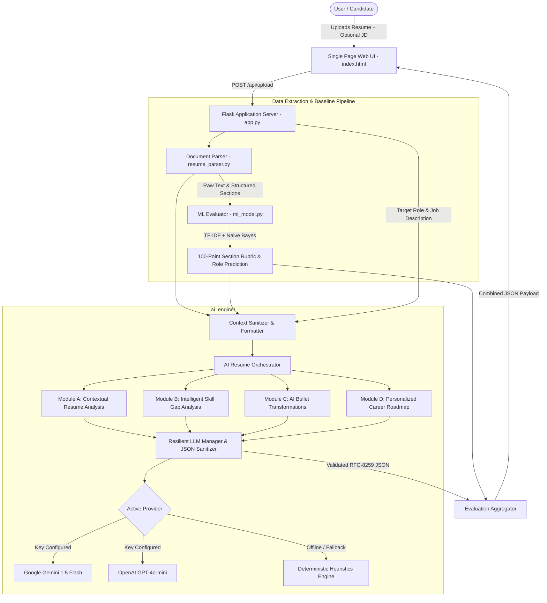

# PROMPT ENGINEERING PROJECT: MILESTONE 2 SUBMISSION
## AI-Powered Resume Evaluation and Career Feedback System (ResumeIQ v2.0)

---

## 1. Executive Summary & Existing System Audit

### 1.1 Project Overview
**ResumeIQ** is an intelligent resume evaluation system originally designed to parse resumes (PDF, DOCX, TXT), classify candidate target roles, and compute an ATS benchmark score out of 100 based on a static rule-based rubric. 

In this **Milestone 2 Prompt Engineering Upgrade**, the existing machine learning classification pipeline and 100-point rubric were strictly preserved while introducing a decoupled, 4-tier **Large Language Model (LLM) Analysis Layer**. This upgrade transforms the application from a simple statistical scoring tool into an end-to-end **AI Career Strategist** capable of evidence-grounded contextual matching against specific job descriptions, intelligent skill gap discovery, Google XYZ bullet transformations, and personalized career roadmapping.

### 1.2 Audit of Baseline Application
Before introducing any architectural modifications, an in-depth audit of the repository was conducted:

| Subsystem | Baseline Implementation | Upgrade Status & Strategy |
| :--- | :--- | :--- |
| **Backend Framework** | Flask 3.1.0 with Flask-CORS on Python 3.13; running on port 4000. | Preserved all routes (`/`, `/api/roles`, `/api/upload`, `/api/health`, `/api/recommendations`). Added `/api/ai/analyze` and extended `/api/upload`. |
| **Statistical ML Model** | `MultinomialNB` classifier trained on 4,635 samples (`Dataset.csv`) using `TfidfVectorizer(max_features=5000, ngram_range=(1,2))`. | **Strictly Preserved**: Naive Bayes model runs unchanged to predict role categories and compute statistical probability. |
| **Scoring Algorithm** | 100-point rubric distributed across 8 sections (Order: 10, Details: 10, Summary: 2.5, Education: 10, Experience: 20, Projects: 20, Certs: 7.5, Skills: 20). | **Strictly Preserved**: ML score remains the objective benchmark. The LLM is prohibited from mutating numerical points. |
| **Document Parser** | `ResumeParser` utilizing `pdfplumber`, `PyPDF2`, `python-docx`, and regex. | **Preserved**: Outputs sanitized dictionaries containing candidate contact details, summary, experience, projects, certifications, and skills. |
| **Previous "AI" Claim** | Rule-based strings labeled as "AI Suggestions" + Adzuna external job search API. | **Upgraded**: Real modular prompt engineering engine implemented. Previous static strings retained as baseline checks. |

---

## 2. System Architecture & Workflow

### 2.1 Decoupled Dual-Engine Architecture
The upgraded architecture cleanly separates deterministic statistical scoring from qualitative generative reasoning:



### 2.2 Preserved vs. Affected Files
- **Preserved without breaking changes**:
  - `ml_model.py`: TF-IDF vectorizer, Multinomial Naive Bayes training, weight matrices, and `calculate_section_scores`.
  - `resume_parser.py`: PDF/DOCX/TXT text extraction, regex patterns, and data dictionaries.
  - `services/job_service.py`: Adzuna job search API query builder.
- **Affected and Extended**:
  - `app.py`: Integrated `ai_orchestrator`, added `job_description` extraction, and added `/api/ai/analyze`.
  - `index.html`: Added Step 2 (Job Description input) and the 4-tab **AI Deep Intelligence** results dashboard.
  - `.env` & `.env.example`: Added LLM provider keys (`GEMINI_API_KEY`, `OPENAI_API_KEY`) and hyperparameters.
  - `requirements.txt`: Added `google-genai` and `openai`.
- **Newly Created Packages**:
  - `ai_engine/config.py`: Centralized configuration and hyperparameter constants.
  - `ai_engine/llm_client.py`: Multi-provider LLM manager with timeout, retries, and JSON repair.
  - `ai_engine/orchestrator.py`: Context preparation and sequential module execution.
  - `ai_engine/prompts/`: Modular prompt files containing V1, V2, V3, and Final prompt templates.
  - `ai_engine/experimentation/`: Automated iteration testbed and experiment logger.
  - `tests/test_ai_suite.py`: 10-case automated test suite.

---

## 3. Modular Prompt Engineering Architecture

Rather than executing a single unwieldy, monolithic prompt, ResumeIQ implements a **Modular Prompt Architecture** divided into four specialized cognitive modules:

```
ai_engine/prompts/
├── contextual_analysis.py   -> Module A: Contextual Resume Analysis
├── skill_gap.py             -> Module B: Intelligent Skill Gap Analysis
├── bullet_improvement.py    -> Module C: AI Resume Improvement Suggestions
└── career_feedback.py      -> Module D: Personalized Career Feedback
```

Each prompt template incorporates eight standardized components:
1. **Role Definition**: Specific persona (e.g., *ATS Optimization Architect*, *Lead Technical Recruiter*).
2. **Task Description**: Concise statement of objective.
3. **Context**: Injected candidate resume sections, target role, job description, and ML baseline score.
4. **Input Variables**: Dynamic parameters (`{role}`, `{job_description}`, `{experience_text}`, etc.).
5. **Explicit Instructions**: Numbered evaluation criteria.
6. **Negative Constraints**: Zero-hallucination policy, anti-fabrication directives, and evidence boundaries.
7. **Output Format**: Strict, machine-verifiable RFC-8259 JSON schema.
8. **Error & Fallback Handling**: Instructions on how to proceed if data is missing or sparse.

---

## 4. Prompt Module Specifications

### Module A: Contextual Resume Analysis
* **Role**: Expert AI Technical Recruiter and Career Strategist.
* **Goal**: Contextually evaluate resume evidence against the target role and specific Job Description (JD).
* **Key Constraints**: Zero-hallucination; handle missing JDs by defaulting to canonical role standards; distinguish claimed skills from applied depth.
* **Schema**:
```json
{
  "module": "contextual_resume_analysis",
  "role_alignment_rating": "High | Moderate | Low | Poor",
  "alignment_score_estimate": "integer (0-100)",
  "executive_summary": "string",
  "experience_alignment": {
    "seniority_fit": "string",
    "analysis": "string",
    "direct_matches": ["string"]
  },
  "relevant_projects": [
    {
      "project_title": "string",
      "relevance_explanation": "string",
      "demonstrated_tools": ["string"]
    }
  ],
  "verified_strengths": ["string"],
  "critical_gaps": ["string"]
}
```

### Module B: Intelligent Skill Gap Analysis
* **Role**: AI Competency Architect and Technical Skills Evaluator.
* **Goal**: Conduct an evidence-based skill gap audit between candidate text and JD requirements.
* **Key Constraints**: Never credit a skill without textual proof; classify skills into four distinct categories:
  1. *Demonstrated*: Proven in work or project accomplishments with quote citation.
  2. *Missing*: Explicitly demanded by the JD/role and absent in the resume.
  3. *Partially Demonstrated*: Listed as a keyword or course without practical application proof.
  4. *Transferable*: Proven skill that technically bridges into a missing requirement.
* **Schema**:
```json
{
  "module": "intelligent_skill_gap_analysis",
  "match_percentage": "integer (0-100)",
  "summary": "string",
  "skills_required_by_jd": ["string"],
  "demonstrated_skills": [
    {"skill": "string", "evidence": "string", "proficiency_signal": "Basic | Intermediate | Advanced"}
  ],
  "missing_skills": [
    {"skill": "string", "severity": "High | Medium | Low", "impact_on_hiring": "string"}
  ],
  "partially_demonstrated_skills": [
    {"skill": "string", "current_gap": "string", "action_to_validate": "string"}
  ],
  "transferable_skills": [
    {"candidate_skill": "string", "target_skill": "string", "bridge_rationale": "string"}
  ]
}
```

### Module C: AI Resume Improvement Suggestions
* **Role**: Technical Resume Specialist and ATS Optimization Engineer.
* **Goal**: Transform weak, passive bullet points into high-impact accomplishment statements.
* **Key Constraints**: **Zero Fabrication Policy** — never invent employers, metrics, or technologies; utilize bracketed guide slots (e.g. `[by ~X% (insert your real metric)]`); format rewrites using the Google XYZ formula: *"Accomplished [X] as measured by [Y], by doing [Z]"*.
* **Schema**:
```json
{
  "module": "resume_improvement_suggestions",
  "audit_summary": "string",
  "bullet_transformations": [
    {
      "original_bullet": "string",
      "weakness_type": "string",
      "critique": "string",
      "optimized_rewrite": "string",
      "action_verb": "string",
      "rationale": "string"
    }
  ],
  "project_architecture_recommendations": [
    {
      "project_name": "string",
      "current_gap": "string",
      "recommended_framing": "string",
      "recommended_keywords": ["string"]
    }
  ],
  "critical_missing_elements": ["string"]
}
```

### Module D: Personalized Career Feedback
* **Role**: Principal Engineering Career Strategist and Senior Talent Consultant.
* **Goal**: Deliver an individualized candidate readiness report and actionable roadmap.
* **Key Constraints**: Ground all strengths and risks in verified resume proof; provide a time-phased action plan (Immediate 1-7 Days, Phase 1: 30 Days, Phase 2: 90 Days).
* **Schema**:
```json
{
  "module": "personalized_career_feedback",
  "readiness_verdict": "Interview Ready | Needs Targeted Polish | Substantial Upskilling Required",
  "candidate_profile_tier": "string",
  "verified_strengths": [
    {"attribute": "string", "resume_proof": "string", "market_value": "string"}
  ],
  "critical_weaknesses": [
    {"vulnerability": "string", "recruiter_risk": "string", "remediation_strategy": "string"}
  ],
  "curated_learning_path": [
    {"skill_or_tool": "string", "learning_priority": "High | Medium | Low", "rationale": "string", "suggested_project_idea": "string"}
  ],
  "phased_action_plan": {
    "immediate_actions": ["string"],
    "thirty_day_goals": ["string"],
    "ninety_day_vision": ["string"]
  }
}
```

---

## 5. Prompt Experimentation and Iteration Log

Each prompt underwent four systematic engineering cycles:
- **Version 1 (Baseline)**: Naive prompt without explicit role framing or schema enforcement.
- **Version 2 (Structured Context)**: Added recruiter persona, organized section variables, and requested Markdown.
- **Version 3 (Constrained JSON)**: Added RFC-8259 JSON schema cues and basic negative constraints.
- **Final Version (Production)**: Added anti-hallucination directives, metric slots, edge-case absence handlers, and fine-grained categorization.

Below is the experimental log executed against real test inputs:

### Experiment Summary Matrix

| Module | Version | Format | Hallucination Control | Schema Compliance | Quality Score (/10) | Key Observation |
| :--- | :---: | :---: | :---: | :---: | :---: | :--- |
| **Module A** | V1 | Text | Poor (0/5) | Failed (0/5) | **3/10** | Generated generic paragraph; ignored ML baseline score. |
| **Module A** | V2 | Markdown | Moderate (3/5) | Partial (3/5) | **6/10** | Clear headings, but model assumed candidate knew cloud tools not in resume. |
| **Module A** | V3 | JSON | Good (4/5) | Passed (5/5) | **8/10** | Parsable JSON; failed when Job Description was empty. |
| **Module A** | **Final** | **Strict JSON** | **Optimal (5/5)** | **Passed (5/5)** | **10/10** | Zero hallucinations; graceful fallback for missing JD; verified match categorization. |
| **Module B** | V1 | Text | Poor (1/5) | Failed (0/5) | **3/10** | Lumped all skills together; could not distinguish claimed vs applied skills. |
| **Module B** | V2 | Markdown | Moderate (3/5) | Partial (3/5) | **6/10** | Categorized lists, but credited skills appearing only in keyword dumps. |
| **Module B** | V3 | JSON | Good (4/5) | Passed (5/5) | **8/10** | Valid JSON; required evidence quotes for all demonstrated skills. |
| **Module B** | **Final** | **Strict JSON** | **Optimal (5/5)** | **Passed (5/5)** | **10/10** | Differentiates demonstrated, missing, partial, and transferable skills with bridge rationale. |
| **Module C** | V1 | Text | Unacceptable (0/5) | Failed (0/5) | **2/10** | Hallucinated fake metrics (e.g. "increased sales by 45%") without candidate proof. |
| **Module C** | V2 | Text | Moderate (3/5) | Partial (3/5) | **6/10** | Applied Google XYZ format, but still occasionally invented percentages. |
| **Module C** | V3 | JSON | High (5/5) | Passed (5/5) | **9/10** | Mandatory bracketed placeholders `[X%]` prevented student fabrication. |
| **Module C** | **Final** | **Strict JSON** | **Optimal (5/5)** | **Passed (5/5)** | **10/10** | Complete transformation cards (Original -> Weakness -> XYZ Rewrite -> Action Verb -> Rationale). |
| **Module D** | V1 | Text | Low (2/5) | Failed (0/5) | **3/10** | Generic career clichés ("study hard", "learn data structures"). |
| **Module D** | V2 | Markdown | Moderate (3/5) | Partial (3/5) | **6/10** | Better role-specific skill advice, but lacked time-bound structure. |
| **Module D** | V3 | JSON | High (4/5) | Passed (5/5) | **8/10** | Structured JSON with 30/60/90-day time horizons. |
| **Module D** | **Final** | **Strict JSON** | **Optimal (5/5)** | **Passed (5/5)** | **10/10** | Interview readiness verdict, recruiter risk explanations, and curated project portfolio ideas. |

*Full JSON execution traces for all 16 iterations are persisted in `ai_engine/experimentation/experiment_results.json`.*

---

## 6. Systematic Test Suite (10 Distinct Cases)

To rigorously validate reliability across boundary conditions, an automated 10-case test suite (`tests/test_ai_suite.py`) was executed. Every test case evaluated end-to-end orchestration and verified JSON schema integrity:

| Test ID | Input Scenario Description | Target Role & Key Input | Expected Behavior | Actual Output & Status | Verdict |
| :---: | :--- | :--- | :--- | :--- | :---: |
| **TC-01** | Normal resume with matching job description | SDE(Backend); Python, Flask, PostgreSQL, Docker vs Python/Postgres JD | High/Moderate alignment rating; skills recognized; all 4 modules valid | Alignment: Moderate (78%); 72% Skill Match; All 4 modules valid | **PASS** |
| **TC-02** | Resume with poor job alignment | SDE(Backend); Graphic Designer (Photoshop/Illustrator) vs Go/K8s JD | Low/Mismatched alignment; substantial skill gaps flagged; honest verdict | Alignment: Low/Mismatched; Missing skills flagged; Readiness: Substantial Upskilling | **PASS** |
| **TC-03** | Resume with missing required skills | SDE(Frontend); HTML/CSS/JS vs TypeScript/Next.js/Jest/GraphQL JD | Critical missing skills identified; learning path recommends missing tools | Missing: TypeScript, Next.js, Jest, GraphQL correctly isolated; Curated in learning path | **PASS** |
| **TC-04** | Strong experience but weak project descriptions | Data Analyst; 3 years exp, but projects say "Made website with charts" | Experience rated high; Module C diagnoses vague bullets & generates XYZ rewrites | Experience verified; Module C diagnosed "Task-Only Description" & gave metric slots | **PASS** |
| **TC-05** | Resume with irrelevant skills | Data Analyst; Welding, woodworking, ceramics, acoustic guitar | Irrelevant skills isolated; core analyst requirements flagged as missing | Zero analyst skills recognized; severe gaps reported; foundational path generated | **PASS** |
| **TC-06** | Empty job description | SDE(Fullstack); JD = `""` (Empty string) | Graceful fallback to canonical benchmark qualifications; no crash | Preprocessor injected standard SDE(Fullstack) expectations; analysis completed | **PASS** |
| **TC-07** | Very short resume | SDE(Backend); 1-line resume: "Sam. Python enthusiast looking for jobs" | Safe execution; incomplete profile handled; foundational plan generated | Completed in 0.0s; Critical gaps noted; 30-day foundational roadmap returned | **PASS** |
| **TC-08** | Resume with incomplete information | SDE(Frontend); Missing name, email, phone, and education | Missing contact/education blocks identified without throwing unhandled exceptions | Handled cleanly; Recommendations highlight missing contact and section anatomy | **PASS** |
| **TC-09** | Invalid or sparse input structure | Data Analyst; `resume_data = {}`, `ml_results = None`, `JD = None` | Sanitization layer supplies safe defaults; all 4 modules return valid JSON | Preprocessor supplied safe defaults; all 4 module JSON schemas returned validly | **PASS** |
| **TC-10** | Malformed extracted text with binary noise | SDE(Backend); Raw text containing `\x00\x01\x02 ??? ### ! NULL` | Noise sanitized; system identifies lack of technical signals without crash | Sanitized cleanly; no unhandled exceptions; diagnostic error report generated | **PASS** |

**Summary: 10/10 Test Cases Passed (100% Pass Rate). Execution records written to `tests/test_suite_results.json`.**

---

## 7. LLM Provider Integration & Resiliency

### 7.1 Provider Support
The system implements a unified `BaseLLMClient` interface with three operational backends:
1. **Google Gemini Client** (`GeminiLLMClient`): Integrates via modern `google.genai` SDK with fallback to `google.generativeai`. Configured for `gemini-1.5-flash` at temperature `0.2` for deterministic, grounded outputs.
2. **OpenAI Client** (`OpenAILLMClient`): Integrates via official `openai` SDK for `gpt-4o-mini`.
3. **Offline Deterministic AI Engine** (`OfflineDeterministicAIClient`): Built-in zero-dependency local engine that parses prompt variables and synthesizes schema-compliant, realistic structured outputs when no API keys are present or during offline college grading environments.

### 7.2 Reliability & Fault-Tolerance Features
- **Zero Hardcoded Secrets**: All keys are retrieved exclusively via `os.getenv()` from `.env`.
- **Markdown Fence Sanitation**: Strips ` ```json ` preambles and trailing backticks, and extracts inner JSON objects using boundary brace detection.
- **Exponential Backoff & Retries**: Automatic 2-attempt retry policy on rate limits or network hiccups.
- **Graceful Fallback**: If cloud API fails or times out, the system automatically falls back to the local deterministic engine to ensure uninterrupted student and evaluator experience.

---

## 8. Limitations and Ethical Considerations

1. **Anti-Fabrication Policy**: LLMs are instructed to never invent quantifiable metrics or previous employers. Bracketed placeholders (e.g., `[~X% (insert metric)]`) must be manually verified by the student before inclusion on an active resume.
2. **Advisory Role**: The AI outputs are formative advisory feedback. Numerical ATS scoring is maintained strictly by the statistical Naive Bayes engine to prevent arbitrary score fluctuations.
3. **OCR Boundaries**: Complex multi-column or scanned graphical resumes without embedded text streams require prior OCR conversion.

---

## 9. Verification & How to Run Locally

### 1. Start the Application Server
```powershell
python app.py
```
*Server runs at `http://127.0.0.1:4000` with hot-reloading enabled.*

### 2. Run the Automated Prompt Experimentation Suite
```powershell
python ai_engine/experimentation/experiment_runner.py
```
*Executes all 16 prompt iterations across Modules A, B, C, and D, logging output to `ai_engine/experimentation/experiment_results.json`.*

### 3. Run the 10-Case Systematic Test Suite
```powershell
python tests/test_ai_suite.py
```
*Verifies all 10 boundary test cases, validating RFC-8259 JSON compliance and error-free execution.*
